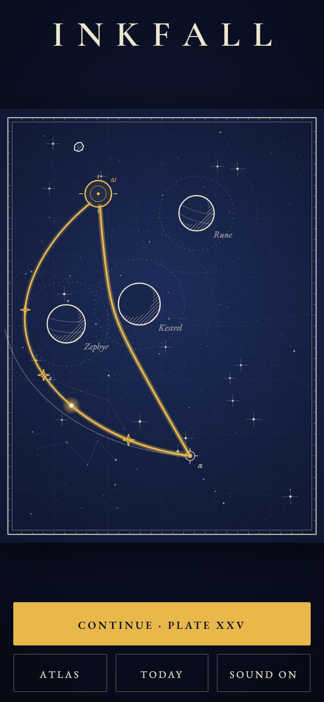
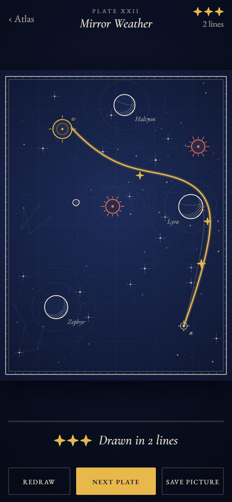
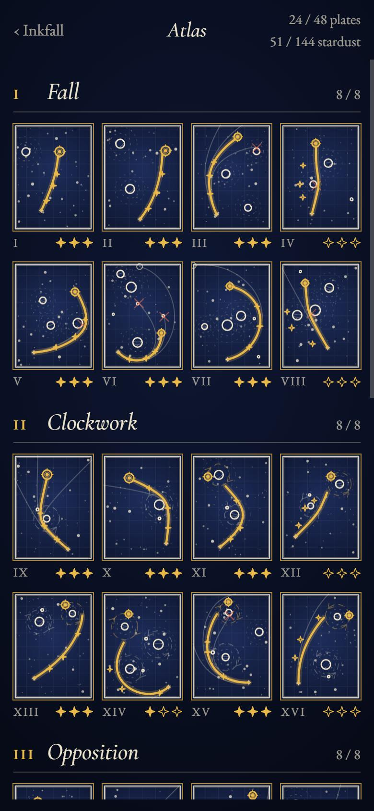

# Inkfall

**You draw the first stroke. Gravity draws the rest.**

<p>
  
  
  
</p>

Inkfall is a small game about drawing one line across a star chart. You choose a direction and a
speed. After that the planets hold the pen. The line must reach the gold ring. Every line you draw
stays on the sheet, so a solved plate is also a drawing that only you made.

- 48 plates in six chapters. Each chapter adds one idea: planets, moons that move, stars that push,
  gates, masses you cannot see, and all of them together.
- A new plate every day, the same for everybody, for 366 days.
- Each plate has an easy answer and a second, more beautiful answer that collects three motes of stardust.
- It runs in a browser, installs on a phone as an app, and works with no network after the first visit.
- No accounts, no ads, no purchases. Progress stays on the device.

## Run it

```bash
npm ci
npm run dev        # http://localhost:5173
npm test           # flies every shipped plate
npm run build      # static site in dist/
```

Controls: drag anywhere on the sheet and release to draw. The two dials change the aim in small
steps, and **Draw** uses the aim that is shown. On a keyboard: arrow keys change the aim (hold
Shift for bigger steps), Enter draws, H gives a hint, N takes a new sheet, Esc goes back.

## How it is made

There is no game engine, no image and no audio file in the game. Under 3,000 lines of plain JavaScript
lay out the skies, draw the charts on a canvas and make the sounds with the Web Audio API. The game
itself is a 23 kB download (gzipped), plus the typefaces. The two serif
typefaces (EB Garamond and Cormorant Garamond, both under the SIL Open Font License) are the only
things that were not written here.

| Part | File | What it does |
|---|---|---|
| Physics | `src/sim/physics.js` | One fixed-step leapfrog integrator. The generator, the tests and the player all use it, so a line that was proved is the same line on the phone. |
| Plate code | `src/sim/codec.js` | A plate is a short array of whole numbers. Whole numbers make a plate identical on every machine. |
| Generator | `src/gen/generate.js`, `tools/generate.mjs` | Lays out a sky from a seed and draws 9,000 test lines through it. See below. |
| Renderer | `src/render/plate.js` | Engraved discs, hatching and hairlines, at any size from a thumbnail to a share picture. |
| Play | `src/game/play.js` | Aiming, the flight of a line, what stays on the sheet. |
| Sound | `src/audio/synth.js` | A small synthesiser. Every note is from one pentatonic scale, so any two sounds agree. |
| Screens | `src/ui/app.js` | Title, atlas and plate. Plain DOM. |
| Offline | `src/sw.js`, `vite.config.js` | The build writes the list of files into the service worker. |
| Icon | `tools/icons.mjs` | Draws the icon pixel by pixel and writes the PNG bytes itself. |

### How a plate is found

Nobody placed these planets by hand. For each plate the generator:

1. lays out a start, a target and bodies from a seed, with rules for the chapter;
2. draws a line for every whole degree and every 4% of speed: 9,000 lines;
3. finds the most forgiving winning aim. This is the *easy answer*, and the hint shows it;
4. finds a second winning aim that turns more, and puts the three motes on its path;
5. checks that both answers still win when the aim is a little wrong, and that the idea of the
   chapter matters: if you take the moons away from a moon plate, the answer must fail.

A sky that fails a check is thrown away and the next seed is tried. The 48 plates of the atlas were
chosen from about 4.5 million test lines. `npm run plates` and `node tools/generate.mjs daily` build
the two data files again; the result is the same on every run.

`npm test` then flies both answers of all 414 plates one more time.

## Branch

This game lives on the branch `inkfall`. The branch has its own history and shares nothing with the
other branches of this repository.
